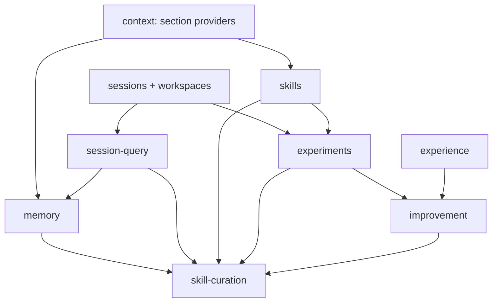

# Память, навыки и рекурсивное улучшение Minerva

Дата: 2026-11-10. Статус: локальный контур памяти, навыков и prompt-only рекурсии реализован; sandbox, произвольные исполняемые компоненты и внешние engine adapters остаются отдельной частью плана. Фактическое поведение: [harness-learning.md](../../harness-learning.md).
Пользователь отдельно согласовал завершение локального контура и перенос runner на следующий этап. Ниже сохранён исходный полный план; он не является заявлением о поставке его sandbox/process частей.
Область: локальный Rust runtime, встроенные и внешние engines, HTTP и Tauri, UI плагинов.
Имена новых методов, пакетов и таблиц ниже — предлагаемые контракты, а не существующие API.

## 1. Результат и границы

Minerva должна искать прежнюю работу, хранить управляемые факты и уроки, загружать актуальные навыки, испытывать варианты обвязки в воспроизводимой среде и переносить подтверждённый опыт между задачами. Все возможности доступны отдельными плагинами; обычный чат работает без памяти и улучшения.

Принимаем полный функциональный объём Harness²: Propose–Probe–Compose, общие и предметные кандидаты, последовательный и параллельный режимы, слепой выбор готового результата, последующая рефлексия, библиотека исполняемых конфигураций и опыта, бюджет, продолжение экспериментов. Восемь типов компонентов описаны в разделе 10. Веса модели не меняются.

Из DeepSeek переносим устройство поиска истории, реестра навыков, подключения memory MCP и процесс подготовки правил из принятых человеческих исправлений. Его частный инструмент сопровождения навыка не доступен для копирования: реализуем собственный процесс по публичному описанию.

Перенос сторонних Memorix/Engram в ядро не нужен: существующий MCP должен уметь подключить любой из них. Собственная память Minerva имеет один источник истины. Одновременное подключение внешней памяти допускается как явный выбор пользователя; автоматической двусторонней синхронизации нет.

## 2. Проверенная исходная архитектура

| Место | Сейчас | Следствие |
| --- | --- | --- |
| `plugins/mh-context/src/lib.rs` | `prepare`, инструкции, каталог/выбор навыков, summary, attachments; одна SQLite connection | Сохраняем контекст как сборщик; навыки выделяем без потери текущих выбранных навыков |
| `plugins/mh-context/src/files.rs` | Обход инструкций и skills, scoped чтение, лимиты | Переиспользуем проверку путей; не ослабляем её ради user skills |
| `plugins/mh-sessions/src/sessions.rs` | `SessionMessage`, `SessionEvent(sessionId,seq,kind,data)`, baseline/cursor | История — источник доказательств; FTS индекс производный |
| `plugins/mh-workspaces/src/lib.rs` | Стабильный workspace ID, привязка сессий, canonical path | Область доступа определяется host по workspace ID, не по переданному моделью cwd |
| `plugins/mh-agent-loop/src/run_supervisor.rs` | Admission, run ownership, отмена, shutdown/join | Дочерние прогоны идут через этот жизненный цикл |
| `plugins/mh-plugin-manager/src/harness.rs` | Подготовленные ссылки на сервисы | Не превращаем Harness в новый orchestrator |
| `crates/plugin-host` и `docs/backend-plugins.md` | Process RPC, `provides/requires`, короткие tools start/poll/cancel/release | Это не готовый интерфейс prompt providers или подписки на события |
| `crates/plugin-sdk/src/context.rs` | Оценка контекста и optional actual usage | Unknown usage нельзя учитывать как ноль |
| `packages/client`, `crates/api`, `src-tauri` | Типизированные transport adapters | Новые методы проходят общий контракт и одинаковую авторизацию |

В checkout есть чужие незавершённые изменения, включая очередь сообщений и backend docs. В реализации сохранять их; исходный baseline каждого этапа фиксировать отдельно. Графа `graphify-out/graph.json` на момент исследования нет; зависимости установлены по прямому чтению кода, граф не строился.

## 3. Карта владельцев

Новые backend ниже — optional compiled-in Cordis-плагины в `plugins/mh-*`. Они поставляются вместе с приложением, но отключаются индивидуально и общей паузой optional plugins. Нынешнее правило «встроенный = обязательный» надо расширить явным lifecycle режимом: нельзя просто добавить новые ID в список обязательных системных сервисов. Для process-расширений открываются только перечисленные host-контракты, без прямого доступа к Rust объектам и SQLite.

| Пакет / ID | Сервис v1 | Владелец | Не делает |
| --- | --- | --- | --- |
| `mh-session-query` / `session-query` | `minerva.history` | Поиск/чтение/trace истории; FTS индекс | Не создаёт факты и уроки |
| `mh-skills` / `skills` | `minerva.skills` | Каталог, providers, версии, загрузка навыков | Не решает, чему учиться |
| `mh-memory` / `memory` | `minerva.memory` | Факты/предпочтения/уроки, recall, консолидация, аудит | Не меняет права и исходную историю |
| `mh-experience` / `experience` | `minerva.experience` | Immutable bundles харнеса, опыт экспериментов, индекс | Не запускает модели, не хранит вторую память пользователя |
| `mh-experiments` / `experiments` | `minerva.experiments` | Изоляция, дочерние прогоны, оценки, budget ledger, артефакты | Не сочиняет правила улучшения |
| `mh-improvement` / `improvement` | `minerva.improvement` | Propose–Probe–Compose, selection, reflection | Не обходит эксперименты и host policy |
| `mh-skill-curation` / `skill-curation` | `minerva.curation` | Исправления → кандидат навыка → проверки → публикация | Не публикует каждое предположение агента |
| Существующий `mh-context` | `studio.context` | Сборка контекста, summary, бюджет | Не владеет memory/skills storage |
| Существующие `mh-mcp`, `mh-tool-runtime` | Существующие сервисы | Внешние memory tools, проверка эффектов/разрешений | MCP сам не добавляет автоматический recall |

`mh-skills` после извлечения — optional; при отключении каталог пуст, `load_skill` недоступен, сохранённый выбор не удаляется. Инструкции AGENTS/CLAUDE остаются в обязательном context. Регистрации должны жить в fiber своего владельца.

Зависимости без циклов:



Стрелка означает dependency от используемого контракта к потребителю. Improvement читает/пишет experience; experience не зависит от improvement. Curation может работать без improvement: его optional наличие даёт кандидатов из экспериментов. Skills и memory регистрируют providers в context; context не импортирует их Cargo-пакеты. Experiments вызывает исполнение через host-owned capability interface, без зависимости agent-loop → experiments.

## 4. Общие DTO, authority и ошибки

Контракты в `crates/plugin-sdk/src/{history,skills,memory,experience,experiments,improvement,curation}.rs`, экспорт в `lib.rs`, wire-типы генерируются существующим `crates/contracts`; не вести вторые ручные TS интерфейсы.

```text
Scope = Session { sessionId } | Workspace { workspaceId } | User
SourceRef = { sessionId, messageId?, eventSeq?, runId?, contentDigest }
ArtifactRef = { artifactId, digest, mediaType, bytes }
Revision = opaque string
Mutation = { requestId, expectedRevision?, ...payload }
Job = { jobId, state, revision, progress?, error? }
```

`SourceRef` требует хотя бы messageId или eventSeq; runId — дополнительная привязка. Для человеческих review: отдельный `ReviewSourceRef { repository, pullRequest, commentId, feedbackCommit, landedCommit, evidenceArtifact }`.

Authority envelope создаёт только host: actor/user ID, session/run ID, workspace ID, local/hosted, permission policy, разрешённые scope и capability. UI/model не могут передать или расширить этот envelope. В single-user local actor фиксированный; hosted tenant берётся из auth. User scope не означает доступ между пользователями.

Поиск по чужому workspace запрещён до получения snippets и counts. В отсутствие workspace сессия видит свою историю и разрешённую user memory. Переезд/смена пути workspace не смешивает права; сессии без старой достоверной привязки не включаются в cross-session search до миграции.

Время хранится UTC, отображается в зоне пользователя. Revision проверяется атомарно; конфликт не затирает более новое значение. Один requestId с иным payload → `REQUEST_CONFLICT`, с тем же → исходный результат. Идемпотентность сохраняется после перезапуска. Аудит записи не содержит ключей и скрытых reasoning-текстов; автоматическое обучение использует пользовательские сообщения, видимый результат, tool outcomes и явно предоставленные отзывы.

Общие ошибки: `INVALID_INPUT`, `NOT_FOUND_OR_FORBIDDEN`, `REVISION_CONFLICT`, `SOURCE_UNAVAILABLE`, `SOURCE_CHANGED`, `PLUGIN_UNAVAILABLE`, `BUDGET_EXHAUSTED`, `USAGE_UNKNOWN`, `CANCELLED`, `STORAGE_ERROR`, `UNSUPPORTED_ENGINE`, `ENVIRONMENT_UNAVAILABLE`. Отсутствие данных и ошибка чтения различимы. Diagnostics доступны оператору, не раскрывают чужие пути/тексты модели.

Стартовые пределы контракта: page ≤100, query ≤2 KiB UTF-8, запись memory ≤16 KiB, skill ≤64 KiB, contribution ≤32 KiB, общие contributions ≤64 KiB. Существующий меньший лимит инструмента/контекста имеет приоритет. Превышение — явная ошибка/ссылка на артефакт, не молчаливое обрезание правила. Курсоры привязаны к запросу, scope и поколению индекса.

## 5. Обязательные расширения host

### 5.1 Context contributions

В SDK добавить `ContextSectionProvider` с `prepare(HostContext, ContextSnapshotRef, Budget) -> Contribution` и lifecycle регистрацией. `Contribution { providerId, revision, scope, kind: reference|guidance, text, sourceRefs, estimatedTokens }`. Provider получает только разрешённый снимок, не raw database handle.

Порядок: host policy → инструкции проекта → выбранные навыки → memory reference → conversation summary → текущая история. Memory всегда помечена как справочные данные; текст памяти не может повысить собственный приоритет. Автоматически извлечённое правило не превращается в developer/system инструкцию.

На шаге фиксируется один согласованный набор revisions, передаваемый и в prompt, и в журнал. Provider с ошибкой помечает шаг degraded: обычный чат может продолжиться с видимым уведомлением; эксперимент, требующий этот компонент, считается invalid. Явно загружаемый skill при ошибке чтения возвращает ошибку. Общий deadline contributions 2 s; медленные provider получают оставшееся время, не по 2 s каждый. Сетевые вызовы и LLM-консолидация не выполняются в этой горячей фазе.

### 5.2 События и host execution port

Над существующим durable журналом добавить typed projections: `run.started`, `step.context_prepared`, `tool.completed`, `run.completed|failed|cancelled`, `session.deleted`, `workspace.changed`. События содержат source IDs/digests, не копии всего transcript. Consumer cursor и обработка at-least-once; store mutation + consumer cursor атомарны в БД потребителя. Подписка регистрируется до replay, watermark устраняет пропуск между replay и live.

В `mh-agent-loop` добавить host execution port `startChild(parentJobId, immutableInput, executionProfile)`, `getChild`, `cancelChild`. Дочерний run имеет собственные session/run IDs, `purpose=experiment|curation`, не отображается как пользовательский новый ответ и не запускает автообучение повторно. Parent отменяет и дожидается всех children. Между заданиями один глобальный concurrency semaphore.

Process v1 существующего SDK эти возможности не поддерживает. В первой поставке новые плагины используют Rust interfaces. Для внешнего расширения добавить явные versioned capabilities `context-provider`, `event-reader`, `child-run-client`: короткие prepare/read/start/poll RPC с host cursors и тем же authority. Не имитировать подписку вложенными `services.call`, не выдавать возможности всем установленным пакетам. Старые пакеты продолжают работать без новых capabilities.

## 6. Контракт `mh-session-query`

Host/API: `history.searchSessions({query,filters,cursor?})`, `history.searchEvents({sessionId,query,filters,cursor?})`, `history.readEvent({sessionId,seq,before?,after?})`, `history.traceSession({sessionId})`, `history.traceEvent({sessionId,seq})`.

Model tools: `session_search`, `session_event_search`, `session_event_read`, `session_trace`, `session_event_trace`. Модель не задаёт authority, SQL или произвольный лимит. UI может листать страницы; model получает bounded hits, `hasMore` и указание сузить запрос.

Hit: `{sessionId,eventSeq?,messageId?,snippet,sourceRef,surface,currentRevision}`. `surface=current|superseded|logOnly`: определяется нашим форматом summary/fork/event, не копируется из DeepSeek без соответствия. Source read проверяет digest; недоступный/изменённый источник не заменяется догадкой.

`history-search.sqlite3`: FTS5 по видимому тексту user/assistant, описаниям/результатам инструментов и summary; без credential payload, binary attachments и reasoning. Идентификаторы и строки запросов параметризованы; FTS syntax экранируется как буквальная фраза. Индекс строится из последовательных снимков `sessions`, сохраняет high-watermark, обрабатывает fork и удаление; перестройка не пишет в исходную историю. Доступ к полному event проходит редактирование секретов и ограничения видимости полей.

Приёмка: новая сессия находит старую своего workspace, читает первоисточник; другой workspace не обнаруживается; удаление убирает hits; crash/rebuild не меняет sessions; fork имеет корректные ссылки и не дублирует inherited hits; после compaction исходный видимый текст остаётся доступен.

## 7. Контракт `mh-skills`

Service: `list(scope) -> {items,incomplete,revision}`, `load({name,revision?})`, `registerProvider(...)`, `invalidate(providerId)`. DTO skill: `{name,description,providerId,revision,instructionPath?,modelInvocable,userInvocable}`. `load_skill` сохраняет совместимость имени и аргументов существующего инструмента.

Roots: существующие project `.agents/skills` и `.claude/skills`; opt-in custom roots и user roots; managed published skills. Выбор: project → custom → user → bundled; внутри слоя фиксированный порядок, коллизия диагностируется. Каталог включает маршрутизационные данные; тело читается при load. Invocation flags строго boolean; invalid skill не выдаётся как разрешённый. За пределами project host явно выдаёт scoped read root; модель не может выбрать произвольный путь.

Тела перечитываются при следующем шаге; invalidate после наших write/edit, внешние изменения замечаются watcher либо bounded rescan. Привязка выбранного skill переносится из существующей `selected_skills` без потери; shared context DB временно обслуживает adapter, после миграции таблицей владеет skills. Не создавать две конкурирующие записи выбора.

Published skill — immutable revision; текущий указатель меняется атомарно. Сеанс может использовать latest, эксперимент всегда pin. Удаление источника/ошибка чтения явно диагностируются. Безопасность scoped file reads сохраняется. Приёмка: изменения видны без restart, оба invocation флага соблюдаются, precedence детерминирован, старый load_skill и выбранные навыки работают, pin не дрейфует.

## 8. Контракт `mh-memory`

Record: `{id,revision,scope,kind:fact|preference|lesson|procedure,text,cue?,sourceRefs[],origin:userExplicit|userCorrection|inferred,status:pending|active|superseded|retracted,confidence?,expiresAt?,supersedes?}`. Confidence — мнение extractor, не доказательство. Для inferred обязательны sourceRefs и pending; явное «запомни» может стать active, но не подтверждает независимую истинность факта.

API: `memory.search`, `memory.read`, `memory.upsert`, `memory.forget`, `memory.proposeConsolidation`, `memory.applyConsolidation`, `memory.audit`, `memory.export`. Model tools: `memory_search`, `memory_read`, `memory_remember`, `memory_forget`. Публикация правил, массовое удаление и применение inferred consolidation — host/UI операции, недоступные как скрытые model mutation.

Upsert содержит expectedRevision, sourceRefs и requestId; batch all-or-nothing. Автоматический duplicate check по scope+нормализованному digest, конфликтующие факты сохраняют обе версии pending до решения. Модельный semantic merge создаёт предложение с before/after, а не перезаписывает active память. Forget исключает запись из recall, индекса и будущих экспортов; удаление источника помечает доказательство unavailable и отзывает основанные только на нём inferred записи. Уже показанные пользователю ответы не переписываются. User purge удаляет тексты/экспорты, оставляя только минимальный tombstone без содержимого; зашифрованные/внешние backups имеют отдельную retention policy.

Recall: bounded active standing facts + lexical topic retrieval, сначала metadata/snippets, полный текст по запросу. Бюджет по умолчанию до 1200 estimated tokens всего и 8 записей, scoped user/workspace, с фактическим списком включённых ID в audit. Стабильный порядок и snapshot per step сохраняют cache prefix. Pending/retracted в prompt не попадают. Optional embeddings — отдельный provider после измерения lexical baseline; отсутствие embeddings не блокирует функциональность.

`memory.sqlite3`: records/revisions/sources/audit/consumer_cursor/FTS. JSON/Markdown экспорт для пользователя, не второй writable backend. UI: просмотр, редактирование, confirm/reject pending, scope, forget, preview consolidation и «почему это вспомнили». Автоматический capture по завершённым ходам включается отдельно; без включения работают явные записи. Не запоминать секреты и reasoning. Не превращать восстановление после падения в повтор LLM-capture с новой мутацией.

Приёмка: write в A → recall в B → применение в ответе; другой workspace не видит project record; override/retraction немедленно меняет recall; adversarial memory не меняет policy; конфликт revisions не теряет запись; capture и consolidation идемпотентны; пустая память не меняет prompt.

## 9. Контракт `mh-experience`

Experience: `{id,domain,scope,cue,lesson,evidenceRefs[],bundleRef,adoptionReason,limitations,confidence,status:provisional|validated|retired,revision}`. Условия применимости и наблюдавшееся изменение обязательны. Выбор результата без контрастного evidence не создаёт transferable lesson. Неудачный эксперимент остаётся в experiments; experience может сохранить доказанный отрицательный урок с границами применения.

Service/API: `experience.search`, `experience.get`, `experience.publish`, `experience.retire`, `experience.export`. Publish принимает completed experiment ID, evidence refs и bundle digest; проверяет существование связей, но LLM-текст не выдаёт за независимую оценку. Индекс выдаёт cue и ссылки; body и bundle читаются по требованию.

`experience.sqlite3` хранит metadata/sources/index; content-addressed `experience/bundles/<digest>` хранит полный manifest и компоненты, атомарная запись через staging. INDEX.md/EXPERIENCE.md — экспорт, не обязательное второе хранилище. `validated` требует выполненный regression gate из раздела 12. Пользователь может отозвать запись; на следующей задаче она не участвует в подборе. Каждый новый task начинается с common baseline + выбранные релевантные компоненты, а не с последнего победившего bundle.

## 10. Контракт `mh-experiments`: исполнение и бюджет

API: `experiments.create`, `start`, `get`, `cancel`, `resume`, `compare`, `artifact`, `export`. Create принимает `{taskRef,baselineBundle,mode:parallel|sequential,k,executorProfile,editorProfile,environmentSpec,budget,validatorSet}`. TaskRef указывает immutable user request и разрешённые source artifacts, не live transcript целиком.

Bundle manifest: `{schemaVersion:1,digest,parentDigest?,components[],scope,sourceRefs}`. Component: `{kind,path,sha256,bytes,adapterVersion}`. Восемь компонентов:

| Тип Google | Адаптация Minerva | Разрешённые изменения |
| --- | --- | --- |
| system prompt | Версионированный task guidance section | Текст поведения под задачей, без перезаписи host identity/policy |
| guardrails | Дополнительные проверки результата/действий | Только сужение разрешений, host denial неотменяем |
| memory | Снимок task-local reference notes | Не править глобальную память из пробного прогона |
| skills | Pinned skill revisions | Новые/изменённые тела в bundle, публикация отдельно |
| tool guidance | Инструкции применения допущенных инструментов | Не добавлять capability через текст |
| scripts | Файлы в sandbox trial | Исполнение только через tool-runtime с его policy |
| subagents | Child workflow definitions: роль, profile, depth, лимиты | Только host child-run port, отмена деревом |
| middleware plugin | Декларативные lifecycle hooks и trusted plugin references | Сгенерированный native код не загружается в основной host; требует isolated runner |

Dynamic native middleware, произвольные внешние процессы и shell требуют настоящего isolated runner. До его реализации такие кандидаты получают `ENVIRONMENT_UNAVAILABLE`, а не выполняются с ослабленными ограничениями. Декларативные hooks доступны раньше. Все восемь типов входят в итоговый объём, но capability matrix честно показывает поддержку каждой среды/engine.

Environment snapshot включает исходные файлы и разрешённые untracked/unsynced изменения, dependency lock digests, tool/plugin versions и artifact inputs. Только git HEAD недостаточно. Не копировать credentials, полный home и чужие файлы. Экспериментальная БД и memory overlays отдельны. Для local file trials — отдельная копия workspace; для shell/network/native — runner с enforcement, один cwd изоляцией не считается. Non-replayable API (почта, production DB, публикация) не запускаются повторно: controlled mock/recorded fixture либо unsupported. Автоперенос результата в исходный workspace отсутствует; нужен preview diff и отдельный apply через обычную политику.

Профиль: executor model ID, доступные generation params/seed, версии engine и tool schema, network policy, неизменный вход. Если provider seed не поддерживает — записать nondeterministic, не обещать идентичные прогоны. Blind evaluation получает deliverables и task inputs без candidate IDs, grader answers скрыты от proposer/reflector. Выбор возвращает существующий artifact, не генерирует новый ответ. Истинный validator (tests/build/domain checks) хранится отдельно от model preference judge.

Budget: `{maxRollouts,maxEditorCalls,maxInputTokens,maxOutputTokens,maxWallMs,maxCostMinor?,currency?,maxConcurrency,maxDepth}`. Пределы общего job и child учитываются одним ledger; резерв перед вызовом, settlement после. При unknown actual usage сохранять estimate и unknown; жёсткий денежный лимит требует известный tariff и ограничиваемый max output, иначе отказ в таком режиме. In-flight перерасход не скрывать; отказ admission до недостаточного резерва. По умолчанию k=1, concurrency=1, depth=1; k≤5 и concurrency≤2 на первой поставке, поднятие лимитов явной конфигурацией. Для k=1 резерв минимум четыре executor rollouts и три editor stages плюс reflection; selection при k>1 резервируется отдельно. Retries считаются, не бесконечны.

Job states: `draft → preparing → running → evaluating → completed`; terminal `failed|cancelled|interrupted|budgetExceeded`. Каждый trial имеет собственный state и immutable input digest. Recovery переводит потерянные процессы в interrupted; resume сверяет environment/model/bundle digests и продолжает только незапущенные этапы. Не повторять uncertain mutation; уже отправленный модельный вызов без подтверждённого результата помечать uncertain, новый вызов — явная новая attempt с дополнительной стоимостью.

`experiments.sqlite3` содержит jobs/trials/stages/budget reservations/usage/evaluations/consumer cursors; blobs в `experiments/artifacts/<digest>`. Один runtime writer, lease с fencing generation для дочерних workers. cancel прекращает admission, отменяет children, join, затем releases. Crash между записью артефакта и ссылкой оставляет GC orphan, не битую completed запись.

## 11. Контракт `mh-improvement`: два уровня рекурсии

API: `improvement.start({experimentId})`, `get`, `cancel`, `resume`. Модельный запуск улучшения допускается как явный инструмент `improve_task` только при включённом режиме и выделенном бюджете. Обычный ход чата не запускает четыре дополнительных решения самовольно.

Для k=1: baseline run → два proposal stages (general/domain) → два probe runs → compose stage → final run → evaluation → reflection → optional experience publication. Compose видит diffs и execution evidence, может оставить baseline; неподтверждённый выигрыш не обязателен. Даже при unchanged bundle final execution учитывается в режиме, заявляющем сравнимость с Google.

Parallel k: k baseline, k general + k domain probes, k composed finals; 4k executor и 3k editor stages. Все compositions получают разрешённый evidence pool. Sequential k: k initial baseline runs, затем k связанных general/domain/compose раундов; каждый следующий получает предыдущий bundle и накопленные evidence, всего также 4k executor runs. При k>1 blind selector выбирает готовый результат из документированного пула finals; baseline fallback фиксируется отдельно. При k=1 selector пропускается.

Improvement library фиксируется на всё время task-level recursion; reflection обновляет её после terminal task. Рефлексия может вернуть no-entry. Формат proposal: `{targetDeficiency,scope:general|domain,baseDigest,componentDiffs,hypothesis,evidenceRefs}`. Compose: `{adoptedDiffs,rejectedDiffs,reasons,evidenceRefs,resultDigest}`. Reflection: `{cue,lesson,evidenceRefs,limitations,bundleDigest}|noEntry`. Формат/пути/допущенные компоненты проверяются host до probe.

Не изменять код самого improver и его selection policy по его же решению. Межзадачное улучшение происходит через библиотеку, а не бесконтрольную самоперезапись orchestrator. После изменения executor/model старый опыт остаётся доступен как provisional для новой конфигурации, без наследования статуса validated.

## 12. Контракт `mh-skill-curation` и применение

API: `curation.propose({sourceRefs,targetSkill,baseRevision})`, `evaluate`, `get`, `publish`, `reject`, `rollback`. Sources: явная пользовательская коррекция с подтверждённым исправлением, validated experience, опциональный импорт human review с before/after commits. Автоматическое распознавание исправлений создаёт pending proposal; сообщение «хорошо» само по себе не доказывает принятие конкретной правки.

Proposal: `{id,sourceRefs[],baseSkillRevision,candidateRevision,diff,rationale,applicability,negativeExample,validatorResults,reviewerVerdicts,state}`. States: `draft → evaluated → ready → published`, альтернативы `rejected|stale|failed`. Два независимо настроенных reviewer adapters для режима human-review learning; сохранять реальную конфигурацию, не объявлять две выборки одной модели независимыми провайдерами. Недостаточные/ошибочные verdicts не превращать в unanimous approval.

Публикационный gate: schema/path/policy validation; проверка triggering case; неизменяемый набор holdout regression cases; обязательные domain validators; ни одной новой hard-check ошибки; для stochastic pass-rate заранее заданные sample count и tolerance; cost/time в заявленном budget. Если данных мало, результат provisional и автоматическая публикация запрещена. Приоритет — measurable correctness, model judge вторичен. Условия и набор кейсов фиксируются до candidate, не редактируются proposer.

Публикация: compare-and-swap base revision → immutable new revision + атомарное переключение pointer + audit. В user/project skill папку запись только через обычную file policy и preview; managed store используется по умолчанию. Drift → stale, не silent rebase. Rollback переключает pointer на существующую revision; следующая задача использует её, активный эксперимент остаётся pinned. Human-reviewed publication — исходный режим; optional auto-publish разрешается пользователем для конкретного scope после прохождения того же gate. Это режим будущей функции, не просьба подтвердить текущую подготовку плана.

## 13. Транспорт, UI, включение и эксплуатация

UI каждого нового плагина — рядом с backend в `plugins/<package>/ui`, существующий plugin SDK и общие компоненты; без второй системы настроек. Панели: «Память», «История», «Навыки», «Опыт», «Эксперименты». Improvement/curation — вкладки experiments/skills, не ещё два пустых экрана. Нужны scope selector, source links, diff, trial compare, budget/unknown usage, cancel/resume, publish/rollback, degraded/error states. Ссылки на источник открывают точную сессию/событие, а не только заголовок чата.

Методы разделов 6–12 регистрируются в общем typed RPC `crates/api/src/rpc.rs` и `packages/client/src/{index,types}.ts` через генерацию. Browser не вызывает process execution RPC напрямую. Tauri получает тот же API через текущий adapter; добавить handlers/allowlist где требуется. Client-models владеют наблюдаемым состоянием, UI не дублирует job state вручную. SSE/WS события — invalidation/progress с cursor; данные дочитываются через typed API.

Settings в `minerva.conf.json`: отдельные blocks для optional plugins, capture/recall scopes, budgets, model profiles, environment providers, publication mode. Credentials остаются в существующем credential store. Новые plugins выключены по умолчанию; пользователь включает готовую группу «Память» или «Улучшение», менеджер показывает зависимые компоненты и их состояние. Никакой скрытой загрузки сторонних пакетов.

Disable/pause останавливает admission и jobs, ждёт children, снимает tools/contributions; выбор пользователя и БД сохраняются. Падение dependency останавливает потребителей без retry текущего действия. Запуск обычного чата возможен в degraded режиме с уведомлением. Hosted получает функции только с tenant authorization и доверенными storage/execution/network providers; до этого API явно unsupported, не local fallback.

Миграции: каждый новый store versioned, transaction + backup до несовместимого изменения, unknown newer schema отклоняется. FTS cache может rebuild, authoritative memory/experience/experiments не сбрасываются. Удаление workspace не удаляет автоматически user memory; его project scope отзывается и предлагается отдельное purge. Импорт/экспорт сохраняет provenance, не экспортирует credential payload; импорт чужого bundle — pending и проходит validation до применения.

## 14. Порядок реализации с проверяемыми выходами

Каждый этап — отдельный reviewable diff. Реализовать весь объём, но не включать недоделанные возможности флагом «работает».

| Этап | Изменения и места | Проверки / выход |
| --- | --- | --- |
| P0: foundation | SDK DTO/errors; host authority adapters; optional compiled-in lifecycle в plugin-manager; context provider registry; durable projections в sessions; API generation | Отказ чужому scope до чтения; duplicate request; disable revokes; provider error/deadline; существующие чаты без новых plugins неизменны |
| P1: history | Новый mh-session-query; sessions snapshot/deletion/fork projections; history API/model tools/UI | FTS rebuild, crash recovery, workspace isolation, fork/compaction source read; реальный новый чат находит прежний факт |
| P2: skills | Извлечь из mh-context; сохранить load_skill/selected_skills; user/custom providers; invocation flags; pin revision; UI | Migration fixture, precedence, scoped path escape, live edit/reload, disabled plugin; contracts/build |
| P3: memory | Новый mh-memory, store/recall/provider/tools/UI; optional capture/consolidation jobs | A→B recall, conflict/retraction/purge, bounded prompt, failure/degraded, no secret capture, crash/idempotency |
| P4: experience | Новый mh-experience, immutable bundles, provenance/index/export/UI | Digest corruption, invalid source, no-entry, scope retirement; no spontaneous global skill activation |
| P5: experiments foundation | Child-run port в agent-loop; mh-experiments ledger/store; engine capability negotiation; snapshots/local runner; API/UI | Equal input trials, dirty files snapshot, unknown usage, reserve race, cancel/join, crash/resume, external effects rejected |
| P6: full execution environments | Isolated runner для shell/network/native middleware; child workflows; per-engine component adapters | Denied network/file access, process-tree teardown, native middleware confinement; 8-component capability matrix для Rig и внешнего engine |
| P7: task improvement | mh-improvement k=1; source-based proposal/compose; validation; artifact result | Fake engine проверяет точную последовательность 4+3; baseline keep; failed probe; невалидный patch; реальный bounded trial с evidence |
| P8: recursion/library | parallel/sequential k>1, blind selector, reflection, library freeze/reuse | Ledger 4k/3k + selector/reflection, cancellation общим деревом, no-entry, domain transfer без leakage, cold resume |
| P9: skill curation | mh-skill-curation; correction/review import; два reviewer adapters; gates; managed publish/CAS/rollback; UI | Stale base не затирается; malformed verdict закрывает gate; regression reject; publish→новый чат→rollback; no recursive self-learning |
| P10: complete acceptance | HTTP + Tauri + external Codex package, docs, migration backup/restore, source/license notices | Полный пользовательский сценарий ниже; подтверждённый report с task/model/budget/engine, cost/time/interventions; ни один skipped trial не считается успехом |

Runtime composition: новые Cargo dependencies добавлять в `Cargo.toml`, plugin-manager builtin registration и `crates/runtime/src/lib.rs` по существующему паттерну. Модельные tools регистрирует их владелец через `mh-tool-runtime`, не общий гигантский workspace-tools switch. Внешний Codex адаптер меняется в соседнем `minerva-codex-plugin` отдельным diff; если он недоступен, его runtime приёмка остаётся явно незавершённой.

Обновить `docs/harness.md`, `docs/backend-plugins.md`, `docs/configuration.md`, `docs/structured-history.md`, `README.md` и protocol docs по факту поставки. В тестах — synthetic sessions и disposable workspaces; пользовательская БД не используется. Новые fixtures: migration old selected skills, deleted source, contradictory memory, dirty workspace snapshot, partial model usage, unknown tool side effect, malicious bundle, interrupted trial, stale publish, valid/invalid reviewer response.

Команды по затронутым этапам: targeted `cargo test -p <package>`, `npm.cmd test`, `npm.cmd run contracts:check`; после интеграции `cargo test --workspace`, `cargo clippy --workspace --all-targets -- -D warnings`, `npm.cmd run build`, `npm.cmd run test:e2e:web`. Для compiler/MSVC окружения использовать существующий проектный запуск. Desktop, реальный model endpoint, process engine и sandbox проверять отдельно: unit tests их не заменяют.

## 15. Сквозная приёмка

1. В disposable workspace пользователь задаёт правило; новая сессия вспоминает его, показывает источник, другой workspace его не получает.
2. Агент находит точный результат старого инструмента после compaction и открывает оригинал.
3. Пользователь исправляет процедуру; исправление сохраняется pending и превращается в candidate skill с before/after evidence.
4. Эксперимент фиксирует dirty workspace и baseline bundle, запускает сопоставимые прогоны, сохраняет diffs, outcome, cost, usage uncertainty.
5. Propose–Probe–Compose формирует выполненный final; hard validator может отклонить красивый, но неверный результат; blind selector не видит меток кандидатов.
6. Reflection сохраняет опыт только с достаточным evidence; следующая другая задача начинает с common baseline и выбирает релевантный опыт.
7. Skill gate пропускает полезное изменение без hard regressions; публикация меняет следующую сессию, rollback возвращает поведение. Active pinned run не меняется.
8. Перезапуск UI не отменяет job; отмена job завершает дерево; перезапуск runtime не повторяет uncertain effects. Pause снимает contributions и tools, данные остаются.
9. Все сценарии воспроизводятся в HTTP, затем desktop; внешнему engine засчитываются только поддержанные и наблюдённые components. Денежный отчёт включает editor/selector/reflection, а не только final run.

Мерить на заранее закреплённых задачах: pass-rate по объективным validators, стоимость целиком, wall time, число вмешательств пользователя, повторные ошибки, долю rejected/provisional изменений. Сравнение с базой использует одинаковый executor и environment; отдельно показать равный бюджет и режим дополнительных вычислений. Самооценка агента не является доказательством прироста.

## 16. Источники и точность переноса

Официальный DeepSeek, commit `fcc0ad462172522aaf5c93a7b2e01f6b9f0b0159`:

- [Session query tools](https://github.com/deepseek-ai/deepseek-harness/blob/fcc0ad462172522aaf5c93a7b2e01f6b9f0b0159/packages/experimental/tool-session-query/README.md): read-only поиск и точное чтение; экспериментальная возможность.
- [FTS provider](https://github.com/deepseek-ai/deepseek-harness/blob/fcc0ad462172522aaf5c93a7b2e01f6b9f0b0159/packages/session-query/session-query-sqlite/README.md): производный индекс истории.
- [Skill filesystem](https://github.com/deepseek-ai/deepseek-harness/blob/fcc0ad462172522aaf5c93a7b2e01f6b9f0b0159/packages/skill/skill-filesystem/README.md): каталог и чтение по требованию.
- [Memory MCP](https://github.com/deepseek-ai/deepseek-harness/blob/fcc0ad462172522aaf5c93a7b2e01f6b9f0b0159/docs/user/guide/mcp-memory.md): официальные примеры подключения сторонней памяти; не собственный memory backend.
- [Skill maintenance](https://github.com/deepseek-ai/deepseek-harness/blob/fcc0ad462172522aaf5c93a7b2e01f6b9f0b0159/docs/cookbook/maintaining-dsh-code-review.md): публичный процесс; реализация private.

Google Harness², commit `6868817518876de8fd170c6a8354daca273b6191`:

- [Recursion](https://github.com/google-research/harness2/blob/6868817518876de8fd170c6a8354daca273b6191/harness2/core/recursion.py), [prompts](https://github.com/google-research/harness2/blob/6868817518876de8fd170c6a8354daca273b6191/harness2/core/prompts.py), [selection/reflection](https://github.com/google-research/harness2/blob/6868817518876de8fd170c6a8354daca273b6191/harness2/core/selection.py): механика task-level адаптации.
- [Library](https://github.com/google-research/harness2/blob/6868817518876de8fd170c6a8354daca273b6191/harness2/core/library.py): adopted bundle и evidence-supported experience.
- [Ledger](https://github.com/google-research/harness2/blob/6868817518876de8fd170c6a8354daca273b6191/harness2/core/ledger.py): 4k execution / 3k improvement stages; selection/reflection вне этих чисел.

DTO, собственный memory backend, host capabilities, sandbox, публикационные gates и UI этого документа — проект Minerva. Они не выдаются за готовые плагины Google/DeepSeek. Нативные проверки безопасности хоста остаются обязательны независимо от изменяемых bundle guardrails. Готовность и прирост качества определяются приёмкой, а не совпадением имён пакетов с upstream.
